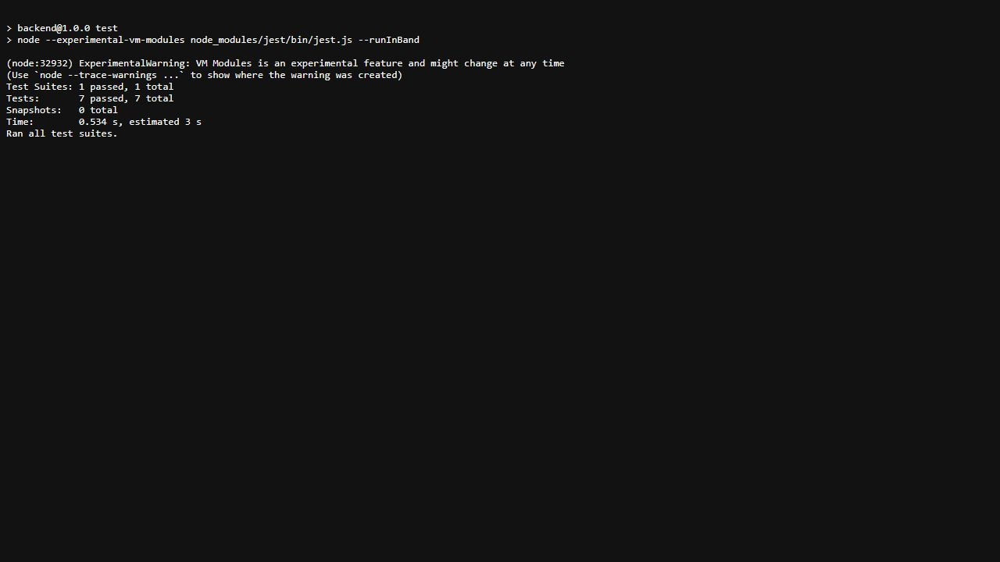
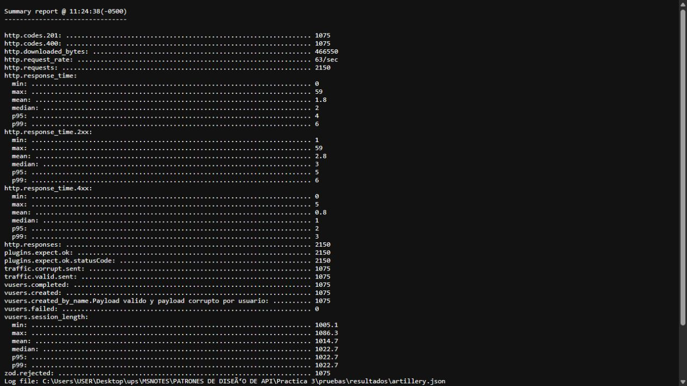
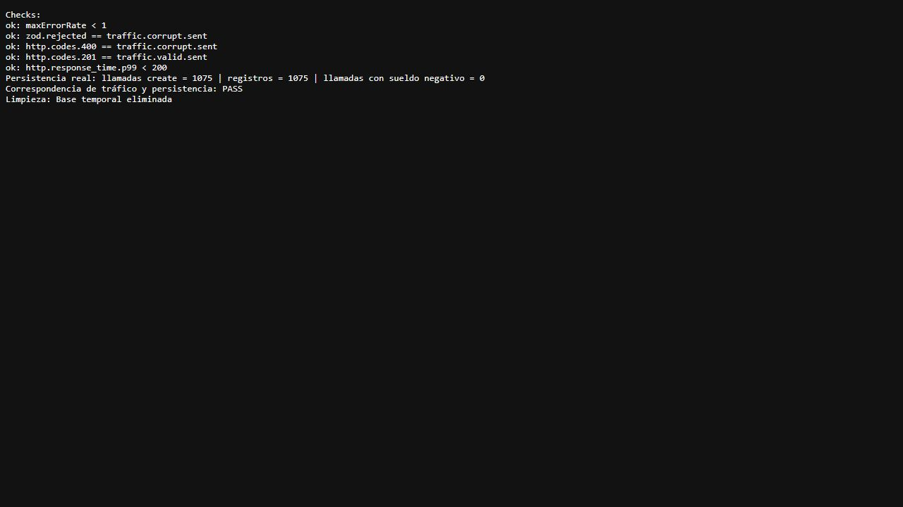

> Las capturas y el análisis original documentan la ejecución del 17 de octubre de 2026. Consulta la [verificación del 22 de octubre](EJECUCION_2026-10-22.md) y sus archivos JSON y logs para los resultados más recientes.

# Informe de ingeniería: aislamiento y rendimiento de la API de empleados

## 1. Objetivo y alcance

Evaluar la modularidad del backend refactorizado con Repository y su comportamiento temporal bajo tráfico válido e inválido. Se utiliza ISO/IEC 25010 como marco de interpretación de mantenibilidad y eficiencia de rendimiento, conforme a la consigna.

La evaluación se realizó localmente sobre Express, Zod y MongoDB real para la carga. Los umbrales de 200 ms y 1 % proceden del enunciado, no de un umbral universal prescrito por ISO/IEC 25010. Los resultados no constituyen una certificación ni una medición de producción.

La copia anterior a los cambios está en [BACKEND_ANTES_DE_PRUEBAS.zip](BACKEND_ANTES_DE_PRUEBAS.zip), con [manifiesto SHA-256](ORIGINAL_SHA256.json) de sus 20 archivos. La consigna se conserva en [CONSIGNA_ORIGINAL.txt](CONSIGNA_ORIGINAL.txt).

## 2. Entorno y adaptación del proyecto

| Componente | Versión comprobada |
|---|---|
| Node local del proyecto | 24.22.0 |
| TypeScript | 6.0.3 |
| Jest | 30.5.2 |
| ts-jest | 29.4.15 |
| Artillery | 2.0.34 |
| Zod | 4.6.5 |
| Mongoose | 9.10.4 |

Se instaló Node como dependencia de desarrollo local para cumplir Node 24+ sin reemplazar el runtime global. Se alineó TypeScript con el rango admitido por ts-jest (`>=4.3 <7`), porque el proyecto utilizaba TypeScript 7. Las versiones están fijadas en el lockfile. [Entorno registrado](resultados/entorno.json).

El controlador existente se crea con `createEmpleadoController(repository)`, en lugar de la clase del ejemplo. Se probó directamente esa implementación, con su interfaz `IEmployeeRepository` y su wrapper de respuesta. Se añadió el alias `/api/v1/employees` para el escenario asignado, conservando `/api/empleados` y sus operaciones.

La carga utilizó una instancia temporal en un puerto libre, registrado en [resultado-ejecucion.json](resultados/resultado-ejecucion.json). El YAML conserva `http://localhost:3000` para la ejecución manual. La base temporal fue exclusiva de esta ejecución y se eliminó después de registrar los resultados; `usuarios_db` no participó.

## 3. Análisis de aislamiento: evidencia Jest

Comando ejecutado desde `backend`:

```powershell
npm.cmd test
```

Resultado: **1 suite aprobada; 7 pruebas aprobadas; 0 pruebas fallidas**.



Los casos verifican listado, paginación, creación válida, rechazo de sueldo negativo, rechazo de ID inválido, empleado ausente y propagación de errores. `findAll` se comprueba con una llamada exacta; `create` no se invoca ante un DTO inválido. Los objetos de Request y Response también son dobles de prueba.

El test no importa Mongoose, modelos de persistencia ni el punto de composición que conecta la base. El resultado de `findAll` se prepara con `mockResolvedValue` y se comprueban el estado 200, el wrapper y sus datos. [Prueba implementada](../backend/src/modules/employee/controllers/employee.controller.spec.ts) y [log de Jest](resultados/jest.log).

**Pregunta de control:** la inversión de dependencias permite que el controlador reciba una implementación de `IEmployeeRepository` sin conocer el motor de persistencia. En la suite, esa implementación es un conjunto de mocks que devuelve objetos planos. Por tanto, la ejecución unitaria no necesita inicializar un contenedor Docker ni una instancia de MongoDB. La conexión real pertenece al punto de composición y se evalúa por separado.

También pasaron el chequeo de tipos y las siete pruebas HTTP de regresión, que incluyen el nuevo alias y la conservación del contrato anterior. [Log HTTP](resultados/api.log).

## 4. Diseño y ejecución de la carga

Se ejecutó Artillery con 20 segundos de calentamiento a 5 nuevos usuarios virtuales por segundo y 30 segundos de rampa de 15 a 50. Cada usuario envió un POST válido, esperó un segundo y envió otro POST con `sueldo: -500`.

El payload válido obtuvo 201 y permitió capturar `$.data._id`. El payload corrupto obtuvo 400 y se verificó que el cuerpo incluyera el error de `sueldo`. En el DTO actual, los textos de dos caracteres son válidos; el sueldo negativo es la infracción de este payload.

El generador registró por separado los envíos válidos y corruptos. Un repositorio instrumentado contó las llamadas reales y una consulta posterior verificó los documentos de la colección. No se sustituyó MongoDB por un mock durante la prueba de carga.

## 5. Resultados colectivos

| Métrica | Resultado observado | Interpretación |
|---|---:|---|
| `vusers.created` / `vusers.completed` | 1.075 / 1.075 | Todos completaron ambos flujos. |
| `http.requests` / `http.responses` | 2.150 / 2.150 | Cada solicitud recibió una respuesta. |
| `traffic.valid.sent` / `http.codes.201` | 1.075 / 1.075 | Todos los envíos válidos terminaron en creación. |
| `traffic.corrupt.sent` / `http.codes.400` | 1.075 / 1.075 | Coincidencia exacta del tráfico corrupto y los rechazos. |
| `zod.rejected` | 1.075 | Los 400 contienen el error contractual esperado. |
| `vusers.failed` | 0 | Tasa de escenarios fallidos: 0 %. |
| `http.response_time.p99` | 6 ms | Cumple el umbral estricto menor que 200 ms. |
| p99 de respuestas 2xx / 4xx | 6 / 3 ms | Se midieron por separado las creaciones y los rechazos. |
| Tiempo HTTP medio / máximo | 1,8 / 59 ms | El máximo no se confunde con el p99. |
| `http.request_rate` informado | 63/s | Valor reportado por Artillery para el agregado. |
| Llamadas a `repository.create` / registros en MongoDB | 1.075 / 1.075 | La persistencia coincide con el tráfico válido. |
| Llamadas al repositorio con sueldo negativo | 0 | La entrada inválida no alcanzó la persistencia. |



Los 1.075 códigos 400 son respuestas esperadas de validación, no caídas de sockets. No se interpreta su proporción del 50 % como error de disponibilidad. El SLA de `maxErrorRate` se evaluó sobre escenarios no completados y pasó con 0 %.

El p99 de duración del usuario virtual fue aproximadamente 1.023 ms porque el flujo contiene `think: 1`. Ese valor incluye la pausa y no es la latencia HTTP evaluada por el SLA.



Evidencias: [artillery.json](resultados/artillery.json), [artillery.log](resultados/artillery.log), [backend-metricas.json](resultados/backend-metricas.json) y [ejecucion-stress.log](resultados/ejecucion-stress.log).

## 6. Análisis del p99 y posible degradación

Se conservaron los valores por ventana del reporte. Los cortes están expresados en hora de Ecuador; la última ventana incluye la finalización de usuarios posteriores al cierre de la rampa.

| Corte informado | Tasa HTTP reportada | p99 HTTP |
|---|---:|---:|
| 11:23:50 | 10/s | 10,1 ms |
| 11:24:00 | 10/s | 5 ms |
| 11:24:10 | 35/s | 4 ms |
| 11:24:20 | 57/s | 4 ms |
| 11:24:30 | 81/s | 5 ms |
| 11:24:40 | 94/s | 6 ms |

La primera ventana registró el máximo global de 59 ms. En las ventanas asociadas al incremento de tráfico, el p99 varió de 4 a 6 ms. Se observa una variación pequeña bajo el SLA; una ejecución con estos agregados no permite identificar una función de crecimiento lineal o exponencial ni demostrar saturación máxima. [Intervalos extraídos](resultados/intervalos.json).

Como observación adicional se registraron retraso y utilización del Event Loop. El máximo de utilización en las muestras de un segundo fue aproximadamente 16,8 %, y el máximo p99 del histograma de retraso por muestra fue 37,52 ms. Este registro incluye preparación de Artillery y carga, y no equivale al p99 HTTP ni identifica por sí mismo una función culpable.

El backend realiza trabajo síncrono en Zod, parseo/serialización JSON y formateo de logs. Bajo cargas superiores podría contribuir a retrasos del Event Loop. Son hipótesis basadas en el código, no causas demostradas de esta medición. Para atribuir una degradación a una de ellas harían falta perfiles de CPU, correlación temporal y repeticiones con cargas adicionales. Las operaciones del repositorio se esperan de forma asíncrona; no se debe confundir la espera de I/O con un bloqueo síncrono del Event Loop.

## 7. Interpretación bajo ISO/IEC 25010

| Aspecto solicitado | Evidencia de esta práctica | Límite de la conclusión |
|---|---|---|
| Mantenibilidad: modularidad | El controlador trabaja con el repositorio mock sin inicializar persistencia. | La suite cubre sus casos seleccionados, no todos los módulos del sistema. |
| Mantenibilidad: capacidad de prueba | Siete casos Jest repetibles y contratos comprobados con tipos. | Un resultado verde no demuestra ausencia de todos los defectos. |
| Eficiencia: comportamiento temporal | p99 HTTP de 6 ms y umbral menor que 200 ms aprobado. | Medición local de una ejecución y un perfil concreto. |
| Eficiencia: capacidad | 1.075 usuarios completados y 2.150 respuestas en la rampa asignada. | La prueba llega a 50 nuevos usuarios/s; no determina el máximo soportado. |

ISO/IEC 25010 proporciona un modelo de calidad para especificar y evaluar características del producto. Aquí se aplica a criterios concretos de la consigna, manteniendo separados datos observados e inferencias.

## 8. Conclusiones

1. La inyección de `IEmployeeRepository` permitió probar el controlador con mocks y mantenerlo independiente de la persistencia. Las siete pruebas unitarias y el chequeo de tipos aportan evidencia del desacoplamiento y de su capacidad de prueba.
2. En el perfil local ejecutado, Zod rechazó exactamente los 1.075 payloads corruptos sin enviarlos al repositorio, y el sistema cumplió un p99 de 6 ms con cero usuarios fallidos. No se alcanzó un límite de capacidad demostrado ni existe evidencia suficiente para atribuir la variación temporal a un cuello de botella síncrono específico.

## 9. Reproducción y fuentes

Desde `backend`:

```powershell
npm.cmd run runtime
npm.cmd run typecheck
npm.cmd test
npm.cmd run test:api
npm.cmd run stress
```

`stress` necesita MongoDB local en el puerto 27017. El comando crea y elimina su propia base temporal; no utiliza la base de datos funcional de la aplicación. Una nueva ejecución reemplaza los archivos de resultados con sus nuevas mediciones; las cifras de este informe corresponden a la ejecución documentada en las capturas.

- [ISO/IEC 25010:2023, modelo de calidad de producto](https://www.iso.org/standard/78176.html).
- [Jest: módulos ESM](https://jestjs.io/docs/ecmascript-modules).
- [ts-jest: soporte ESM](https://kulshekhar.github.io/ts-jest/docs/guides/esm-support).
- [Artillery: ensure](https://www.artillery.io/docs/reference/extensions/ensure).
- [Artillery: motor HTTP](https://www.artillery.io/docs/reference/engines/http).
